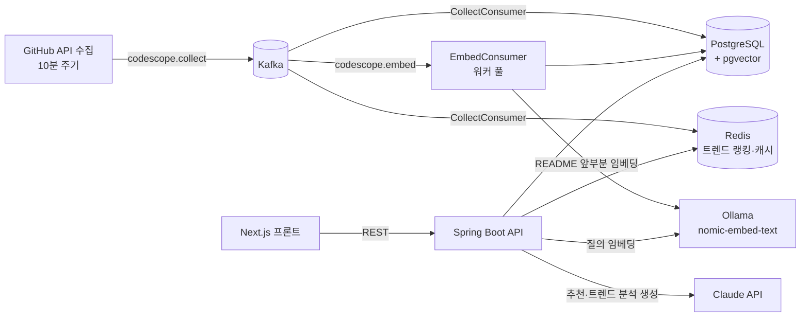

# CodeScope

GitHub 트렌딩 레포를 수집·임베딩하여 RAG 기반 유사 프로젝트 추천과 트렌드 분석을 제공하는 플랫폼.

## 왜 만들었는가

GitHub Trending은 순위만 보여줄 뿐 "왜 뜨는가", "내가 기여할 수 있는가", "내 스택과 맞는 프로젝트가 어디 있는가"는 알려주지 않는다. 실시간 수집과 AI 분석, 벡터 유사도 검색을 결합해 이 질문에 답해보려는 학습 목적 프로젝트다.

## 아키텍처



수집 → Kafka → 임베딩 → pgvector 저장 → RAG 추천 / 트렌드 분석 순으로 이어지는 파이프라인이다. 중간 단계 실패로 임베딩이 없는 레포가 섞이지 않도록, RAG 추천 쿼리는 `ProcessStatus=EMBEDDED`인 레포만 대상으로 한다.

## 주요 기능

| 기능 | 화면 | 동작 |
|---|---|---|
| 레포 탐색 | `/explore` | 키워드(이름·설명)·언어·최소 스타 필터, 페이지네이션 (QueryDSL 동적 쿼리) |
| 트렌드 랭킹 | `/`, `/trending` | 수집 시 Redis Sorted Set에 스타 수를 멱등(ZADD) 반영해 순위 조회 |
| AI 트렌드 분석 | `/repos/{id}` | "왜 뜨는가"를 지표만 근거로 Claude가 분석 (Redis 1시간 캐시 + DB 영구 저장) |
| AI 레포 추천 (RAG) | `/recommend` | 스택 → 질의 임베딩 → pgvector 유사도 상위 10개 → Claude가 그 목록 안에서만 추천 |
| 관심 스택 | `/me` | 로그인 사용자의 스택 저장 → 입력 없이 "내 스택으로 추천" |
| 즐겨찾기 | `/favorites` | 레포 북마크 (UserFavorite 매핑 엔티티) |
| 로그인 | `/login` | GitHub OAuth → JWT Access(메모리) + Refresh(HttpOnly 쿠키, Redis 회전) |

로그인 없이도 탐색·트렌드·상세·AI 추천을 쓸 수 있고, 로그인하면 즐겨찾기와 관심 스택이 열린다.

## 기술 스택

| 기술 | 선택 이유 |
|---|---|
| Java 21 (가상 스레드) | GitHub·AI·DB 호출처럼 I/O 대기가 많은 구조에 적합 |
| Spring Boot 3.5 | 생태계와 가상 스레드 지원이 성숙한 백엔드 프레임워크 |
| PostgreSQL + pgvector | 별도 벡터 DB 없이 기존 트랜잭션 안에서 벡터 검색 처리 |
| QueryDSL | Q클래스가 컴파일 시점에 생성돼 동적 검색 조건을 타입 안전하게 조합 |
| Redis | 트렌드 랭킹(Sorted Set)·캐싱·중복 수집 방지 락에 활용 |
| Kafka | 브로커에 영속 저장되어 앱 재시작에도 작업이 유실되지 않음 |
| Flyway | 스키마 변경 이력을 코드로 관리해 팀/환경 간 정합성 확보 |
| Claude API (공식 Java SDK) | 추천·트렌드 분석 텍스트 생성. 로컬 CPU 추론(1.3~1.9 tok/s, 1건 90~160초)과 소형 모델의 반복·다국어 열화 한계로 교체 |
| Ollama (nomic-embed-text) | 임베딩. Claude API에는 임베딩 엔드포인트가 없고, 로컬이라 비용 0 |
| GitHub OAuth + JWT | 서비스 정체성과 맞고, 비밀번호 직접 관리 부담을 줄임 |
| Next.js 16 + React 19 | 프론트엔드 (UI 라이브러리 없이 CSS 변수 기반 다크 테마) |
| kind (로컬 K8s) | 로컬에서 실제 K8s 환경을 그대로 재현 |
| GitHub Actions + ArgoCD | CI/CD와 GitOps 기반 배포 자동화 |

## 가상 스레드 활용

- **HTTP 요청 처리**: 톰캣이 요청마다 가상 스레드를 할당해, GitHub API·Ollama 호출처럼 I/O 대기가 긴 작업에서도 캐리어 스레드를 반납하고 다른 요청을 처리할 수 있게 함. 톰캣 스레드 수 자체를 줄이는 방식은 인바운드 요청까지 막아버리는 안티패턴으로 보고 채택하지 않음
- **Kafka 컨슈머 워커 분리**: `EmbedConsumer`는 poll 스레드에서 메시지를 받으면 실제 임베딩 처리는 가상 스레드 기반 `embedWorkerExecutor`로 위임한다. 재시도 백오프(최대 3회, 1s→2s 지수 백오프)로 워커가 오래 블로킹돼도 poll 스레드는 영향받지 않아 Kafka 하트비트/`max.poll.interval.ms` 초과로 인한 리밸런싱 폭주를 막는다
- **배압 제어(세마포어)**: GitHub API/OpenAI API용 세마포어와 DB 세마포어(HikariCP `maximum-pool-size`와 permits 일치)를 분리 설계해, 가상 스레드가 많아져도 하위 시스템(외부 API rate limit, DB 커넥션 풀)이 고갈되지 않도록 함
- **pinning 검증**: `synchronized`나 구버전 JDBC 드라이버는 가상 스레드를 캐리어 스레드에 고정(pinning)시켜 가상 스레드의 이점을 무력화할 수 있어, JDK Mission Control(JFR)의 `jdk.VirtualThreadPinned` 이벤트로 별도 검증

## Kafka 파이프라인

수집(Collect)과 임베딩(Embed) 두 단계를 별도 토픽으로 분리했다.

- `codescope.collect`: GitHub 레포 수집 메시지. `CollectConsumer`가 소비해 DB에 저장(fullName UNIQUE 제약으로 멱등성 보장) 후 `codescope.embed`로 다음 단계를 발행
- `codescope.embed`: 임베딩 대상 메시지. `EmbedConsumer`가 소비해 README 수집 → Ollama 임베딩 생성 → pgvector 저장까지 수행
- **재시도/DLT**: `@RetryableTopic`(3회, 1000ms 지수 백오프 ×2.0)으로 재시도 토픽을 자동 구성하고, 모두 실패하면 DLT(Dead Letter Topic)로 이동. 4xx(404/401/403)처럼 재시도해도 결과가 바뀌지 않는 에러는 즉시 최종 실패로 확정
- **오프셋 커밋 시점**: poll 스레드는 메시지를 워커에 위임만 하고, 실제 임베딩이 성공 또는 최종 실패로 확정된 뒤에야 `ack.acknowledge()`를 호출 — 처리 중인 메시지가 성급하게 커밋 완료로 처리되지 않도록 함
- Consumer 오프셋 역전을 막기 위해 메시지 "소비" 자체는 순차 처리하고(concurrency는 파티션 단위로만 확장), 가상 스레드 병렬화는 I/O 대기 지점(워커 내부)에만 적용

## N+1 문제 및 QueryDSL

`GithubRepository`-`Topic`은 `@ManyToMany(LAZY)`라 목록 조회 후 각 레포의 Topic을 순회하면 레포 개수만큼 추가 쿼리가 발생한다.

| 데이터 규모 | `findAll()` (개선 전) | `findAllWithTopics()` - JOIN FETCH (개선 후) |
|---|---|---|
| 레포 5개, Topic 5개 | 6번 (1 + 5) | 1번 |
| 레포 100개, Topic 20개 | 101번 (1 + 100) | 1번 |

페이징이 필요 없는 목록 조회는 JOIN FETCH로 해결했다. 다만 컬렉션 fetch join과 페이징을 함께 쓰면 Hibernate가 메모리 페이징을 하게 되는 문제가 있어, 페이징이 필요한 동적 검색 API(`GithubRepositoryQueryRepository`)는 QueryDSL의 `BooleanBuilder`로 조건을 조합하고 topics는 fetch 대신 `@BatchSize(size = 100)`로 배치 조회(`WHERE repo_id = any(?)` 1번)하도록 분리했다.

## LLM 호출 설계

- **구현체 교체가 설정 하나로:** `LlmClient`와 `EmbeddingService` 인터페이스 뒤에 Claude, Ollama, stub 구현체가 있다. `llm.generation.provider`와 `llm.embedding.provider`로 고르고, 호출부는 어떤 모델인지 모른다.
- **트랜잭션 밖에서 호출:** LLM 응답을 기다리는 수 초 동안 DB 커넥션을 쥐지 않도록 OSIV를 끄고 서비스 트랜잭션을 "조회 → LLM → 저장"으로 나눴다. 회귀 테스트 `LlmCallTransactionBoundaryTest`가 이를 검사한다.
- **입장 제어(load shedding):** 동시 호출은 세마포어로 제한한다. 대기가 5초를 넘으면 무한정 기다리지 않고 **503 + Retry-After**로 즉시 돌려보낸다. 프론트는 카운트다운 후 재시도를 안내한다.
- **비용 통제:** 트렌드 분석은 상세 화면에서 버튼을 눌러야 요청하고, Redis에 1시간 캐싱한다. 같은 레포에 캐시 미스가 동시에 몰리면 `@Cacheable(sync = true)`로 1회만 호출한다. 토큰 사용량은 Prometheus 지표로 남긴다.
- **임베딩 입력:** README 전체를 잘게 나눠 평균 내지 않는다. 이름·설명·언어와, 배지·HTML·URL을 걷어낸 README 앞부분 2,000자만 1회 호출한다. 레포당 호출이 평균 82회에서 1회로 줄었고, 검색 MRR@10은 0.861에서 0.938로 올랐다.

## 부하테스트 및 모니터링

배압 제어(세마포어)를 켰을 때와 껐을 때의 차이를 실측으로 확인하기 위해 아래 도구들을 함께 사용했다.

- **JMeter**: GUI 기반으로 시나리오 설계가 쉬워 초기 부하 시나리오 구성에 사용
- **k6**: 스크립트(JS) 기반이라 코드로 관리하고 CI에 연동하기 쉬움
- **InfluxDB + Grafana**: 부하테스트 중 응답시간/처리량을 시계열로 실시간 시각화
- **JDK Mission Control (JFR)**: 가상 스레드 pinning(`jdk.VirtualThreadPinned`) 여부를 관찰
- **Prometheus + Grafana "JVM / GC / 배압" 대시보드**: 힙, GC pause, 할당률, HikariCP, 세마포어 대기열, LLM 거절률을 k6 결과와 같은 시간축에서 대조
- **`./gradlew bootRunLoadTest`**: stub LLM(API 비용 0, 같은 세마포어를 거침)으로 띄우고, 힙을 고정한 채 JFR과 GC 로그를 남긴다. `-Pgc=zgc`로 GC를 비교할 수 있다. 분석은 `scripts/jfr-report.sh`가 맡는다. 자세한 절차는 [`docs/performance/loadtest-guide.md`](docs/performance/loadtest-guide.md)에 있다.

## 성능 실측 요약

> 측정 환경: 로컬 kind 클러스터(k8s), 12 logical processors, GPU 없음(Ollama는 CPU-only 추론). 출처: `docs/performance/`

| 항목 | 조건 | 결과 |
|---|---|---|
| pgvector 검색 (DB 실행, `EXPLAIN ANALYZE`) | repo_embeddings 20행 / github_repository 30행 중 EMBEDDED 3행 | Execution Time 2.257ms |
| pgvector 검색 (앱 측, HikariCP 커넥션 포함) | 앱 재시작 후 첫 호출(콜드) | 3134ms |
| pgvector 검색 (앱 측, HikariCP 커넥션 포함) | 두 번째 호출부터(웜) | 185ms |
| RAG 생성(LLM) | llama3.2:3b, num_predict=200, 워밍업 상태 | eval 91.07초(1.68 tok/s) / 전체 142.76초 |
| 트렌드 분석 캐시 미스 | 1차 호출(LLM 실제 호출) | 71.24초 |
| 트렌드 분석 캐시 히트 | 2차 호출(Redis TTL 1시간 내) | 0.081초 (약 880배 개선) |
| DB 세마포어 배압 제어 — 없음 (JMeter, `GET /api/repos/{id}` 관찰) | useSemaphore=false | 평균 160ms / 최대 1453ms / 처리량 41.5 |
| DB 세마포어 배압 제어 — 있음 (JMeter, `GET /api/repos/{id}` 관찰) | useSemaphore=true, reserve=2, permits=8 | 평균 16ms / 최대 325ms / 처리량 89.2 |
| k6 부하테스트 (`repo-detail.js`, 세마포어 활성) | 10s ramp-up → 30s steady 10 VUs → 10s ramp-down | p(95)=285.21ms, 실패율 0%, threshold(`p(95)<500ms`, `rate<0.01`) 통과 |

### 2026-10-13 로컬 실측 (macOS, kind + 호스트 앱, k6 mixed 20rps 1분, stub LLM 2초)

| 항목 | 수정 전 | 수정 후 |
|---|---|---|
| LLM 무관 조회 p95 (커넥션 풀 고갈 → OSIV off + 트랜잭션 분리) | 30.0s · 실패율 12.9% · Hikari pending 211 | **9.4ms · 0% · 0** |
| 추천 p95 (대기열 무한 증가 → 5초 상한 + 503) | 57.3s | **7.1s** (서버 오류 0%, 41.7%는 의도된 503) |
| 30건 버스트 임베딩 (즉시 거절 → 최대 60초 대기) | 3건 영구 FAILED | **30/30 EMBEDDED** |
| 임베딩 호출 (README 전체 청크 평균 → 앞부분 1회) | 레포당 평균 82회, 30건 약 37초 | **레포당 1회, 1.8초** |
| 검색 품질 MRR@10 (`scripts/embedding-eval.py`) | 0.861 | **0.938** |

상세: [`docs/performance/llm-tx-boundary-and-embed-burst.md`](docs/performance/llm-tx-boundary-and-embed-burst.md), [`docs/troubleshooting.md`](docs/troubleshooting.md)

## 실행 방법

### 0. 준비

```bash
# macOS (Windows는 JDK 21 / Docker Desktop / kind / kubectl / k6를 각각 설치)
brew install openjdk@21 kind kubectl k6 ollama
ollama pull nomic-embed-text          # 임베딩 모델 (생성은 Claude API)
cp .env.example .env                  # GitHub OAuth·토큰, JWT_SECRET, ANTHROPIC_API_KEY 등 채우기
```

`.env`는 `.gitignore` 대상이다. Spring이 기동할 때 루트의 `.env`를 자동으로 읽는다(`spring.config.import`).

### 1. 인프라 (kind: PostgreSQL + pgvector / Redis / Kafka)

```bash
./scripts/local-up.sh      # macOS·Linux  (Windows: ./scripts/local-up.ps1)
./scripts/local-down.sh    # 종료         (Windows: ./scripts/local-down.ps1)

./scripts/local-up.sh --monitoring   # + Grafana(:3001) / Prometheus(:9090) / InfluxDB(:8086)
./scripts/local-down.sh --delete-cluster   # 클러스터까지 삭제(데이터 소멸)
```

**앱/프론트엔드까지 클러스터에 배포** (bootRun·npm run dev 없이, macOS):

```bash
./scripts/local-up.sh --app   # 이미지 로컬 빌드 → kind load → .env로 Secret 생성 → k8s/overlays/local 적용
                              # 화면 http://localhost:3000 / API http://localhost:8080 (port-forward)
```

- GHCR 이미지는 amd64 전용이라 Apple Silicon에서는 로컬 빌드 이미지(`k8s/overlays/local`)를 쓴다.
- 재부팅 후에는 옵션 없이 `./scripts/local-up.sh`만 실행하면 배포된 앱의 port-forward가 복구된다. 코드나 `.env`를 바꿨을 때만 `--app`.
- 클러스터 앱과 `bootRun`을 동시에 띄우지 않는다(같은 Kafka 컨슈머 그룹을 나눠 가짐). 부하테스트 전에는 `local-down.sh`로 앱 Pod를 내린다.

### 2. 백엔드 / 프론트엔드

```bash
./gradlew bootRun                          # http://localhost:8080 (Swagger: /swagger-ui.html)
cd frontend && npm ci && npm run dev       # http://localhost:3000
```

API 비용 없이 화면만 확인하려면 `LLM_GENERATION_PROVIDER=stub ./gradlew bootRun`으로 띄운다.

### 3. 테스트

```bash
./gradlew test                                              # 인프라(Postgres/Redis) 필요, 외부 API 호출 없음
set -a && source .env && set +a && ./gradlew liveTest      # 실제 Claude API 1회 호출 (1센트 내외)
```

### 4. 부하테스트 · GC/JFR

```bash
cd infra-monitoring && docker compose up -d                # Grafana :3001 / Prometheus :9090 / InfluxDB :8086
./gradlew bootRunLoadTest                                  # stub LLM + JFR + GC 로그 (build/loadtest/)
k6 run --out influxdb=http://localhost:8086/loadtest -e REPO_IDS=4,5,6 infra-monitoring/loadtest/scenarios.js
scripts/jfr-report.sh build/loadtest/app-g1-*.jfr          # GC·할당·pinning 리포트
scripts/loadtest-cleanup.sh                                # 앱 종료 후, stub 분석 결과 정리
```

임베딩 방식을 바꿨다면 `scripts/embedding-eval.py`로 변경 전후의 검색 품질을 비교한다.
